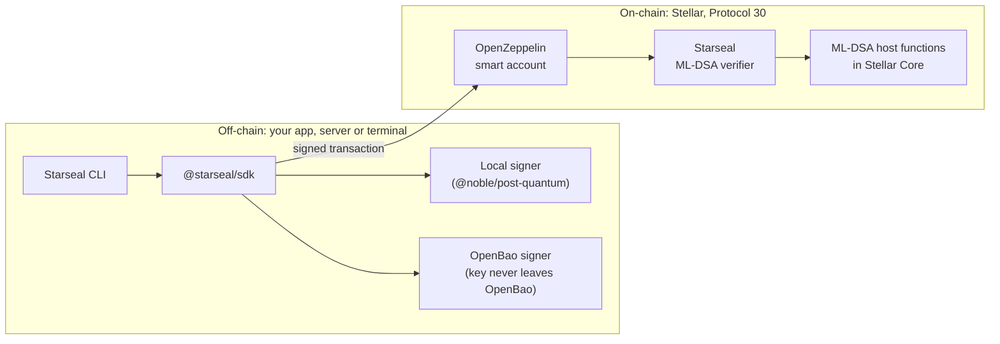
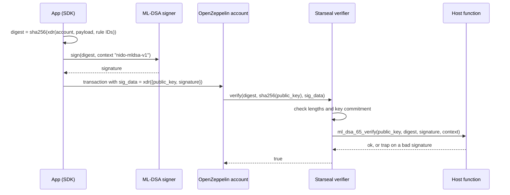

# Starseal

**Post-quantum signers for Soroban smart accounts.**

[](https://github.com/Starseal-soroban/Starseal/actions/workflows/ci.yml)
[](LICENSE)


Starseal lets an [OpenZeppelin smart account](https://docs.openzeppelin.com/stellar-contracts/accounts/smart-account) on Stellar require an **ML-DSA** signature ([FIPS 204](https://csrc.nist.gov/pubs/fips/204/final)), the NIST post-quantum signature standard. Verification runs on-chain through the ML-DSA host functions that Protocol 30 ("Bell") adds to Soroban. Signing keys can live in your app or in [OpenBao](https://openbao.org), a free, self-hosted key service.

> [!WARNING]
> **Early development.** Nothing here is audited. Use testnet only, and never protect real funds with it.

## Contents

- [Why Starseal](#why-starseal)
- [How it works](#how-it-works)
- [What's in the repo](#whats-in-the-repo)
- [Signature format](#signature-format)
- [Verifier contract reference](#verifier-contract-reference)
- [Getting started](#getting-started)
- [Using the verifier with a smart account](#using-the-verifier-with-a-smart-account)
- [Security model](#security-model)
- [Costs and sizes](#costs-and-sizes)
- [Roadmap](#roadmap)
- [FAQ](#faq)
- [Contributing](#contributing)
- [Acknowledgements](#acknowledgements)
- [License](#license)

## Why Starseal

A large enough quantum computer could forge today's elliptic-curve signatures, including the Ed25519 keys that guard most Stellar accounts. Stellar's [Quantum Preparedness Plan](https://stellar.org/blog/foundation-news/introducing-the-quantum-preparedness-plan) starts by letting smart contracts verify post-quantum signatures, so contract accounts can opt in to quantum-safe authorization first.

Protocol 30 delivers that step. [CAP-87](https://github.com/stellar/stellar-protocol/blob/master/core/cap-0087.md) adds `verify_sig_ml_dsa_44`, `verify_sig_ml_dsa_65` and `verify_sig_ml_dsa_87` to Soroban. Testnet upgraded on 3 November 2026, and the mainnet vote is on 23 November 2026.

Starseal builds the pieces around those host functions:

- **A verifier contract** that plugs into OpenZeppelin smart accounts as a new signer type, using the host functions instead of verifying ML-DSA in contract code.
- **A signing SDK and CLI** (in progress) that produce those signatures from keys held locally or in a key service.
- **Compatibility with existing work.** Starseal uses the same signature format as the [Perch](https://github.com/stellar-registry/perch) and [nido](https://github.com/nidohq/nido) verifiers, so keys and signatures move freely between them.

## How it works



One authorization, step by step:



The account recomputes the digest itself, so a signature only authorizes the exact account, host payload and context rules it was made for.

## What's in the repo

| Path | What it is | Status |
| --- | --- | --- |
| [`contracts/mldsa-verifier`](contracts/mldsa-verifier) | OpenZeppelin-compatible verifier for ML-DSA-44, -65 and -87, using the host functions | Working, tested |
| [`test-vectors`](test-vectors) | Signatures made with `@noble/post-quantum`, checked against the host in CI | Working |
| `packages/sdk` | `@starseal/sdk`: one signer interface with local and OpenBao backends, auth digest and `sig_data` encoding | Planned |
| `packages/cli` | `@starseal/cli`: `starseal keygen`, `key create`, `add-signer`, `sign`, `verify` | Planned |
| `examples/` | An ML-DSA-only rule; a passkey or Ed25519 signer plus ML-DSA, both required | Planned |

## Signature format

The format is shared with Perch and nido. Changing any part of it breaks compatibility, so it only changes through a discussed issue.

| Field | Value |
| --- | --- |
| `key_data` (stored by the account) | `sha256(public_key)`, 32 bytes |
| `sig_data` (sent with each authorization) | XDR of the map `{ public_key: Bytes, signature: Bytes }` |
| Message signed | The account's 32-byte auth digest |
| Signing mode | Pure `ML-DSA.Sign` (not HashML-DSA), hedged or deterministic |
| Context string | `nido-mldsa-v1` |

The account stores a commitment rather than the key because OpenZeppelin caps external key data at 256 bytes, and ML-DSA public keys are larger. Each signature therefore carries its public key, and the verifier checks it against the commitment.

The verifier reads the security level from the public key's length:

| Parameter set | NIST category | Public key | Signature |
| --- | --- | --- | --- |
| ML-DSA-44 | 2 | 1,312 bytes | 2,420 bytes |
| ML-DSA-65 | 3 | 1,952 bytes | 3,309 bytes |
| ML-DSA-87 | 5 | 2,592 bytes | 4,627 bytes |

## Verifier contract reference

The contract is stateless, has no constructor, no admin and no upgrade path. One deployment can serve every account on a network.

| Function | Arguments | Returns |
| --- | --- | --- |
| `verify` | `hash: Bytes` (32), `key_data: BytesN<32>`, `sig_data: Bytes` | `true` if the signature is valid; `false` if the public key doesn't match `key_data` |
| `canonicalize_key` | `key_data: BytesN<32>` | The commitment itself, used by the account to reject duplicate signers |
| `batch_canonicalize_key` | `key_data: Vec<BytesN<32>>` | One canonical key per input, in order |

A signature that fails verification **traps** rather than returning `false`, because the ML-DSA host functions have no boolean form. The account's authorization fails either way. Malformed input traps with one of these errors:

| Code | Error | Meaning |
| --- | --- | --- |
| 1 | `DigestLength` | `hash` is not 32 bytes |
| 2 | `SigDataEncoding` | `sig_data` is not the expected XDR map |
| 3 | `PublicKeyLength` | The public key length matches no ML-DSA parameter set |
| 4 | `SignatureLength` | The signature length doesn't match the public key's parameter set |

## Getting started

### Prerequisites

- [Rust](https://rustup.rs) 1.91 or newer, with `rustup target add wasm32v1-none`
- [Stellar CLI](https://github.com/stellar/stellar-cli) 30 or newer. soroban-sdk 30 only builds contracts through Stellar CLI 30+.
- [Node.js](https://nodejs.org) 22 or newer and [pnpm](https://pnpm.io) 10

### Build and test

```sh
git clone https://github.com/Starseal-soroban/Starseal
cd Starseal

cargo test                                          # contract unit and vector tests
stellar contract build --package starseal-mldsa-verifier

pnpm install
pnpm lint && pnpm typecheck && pnpm test           # TypeScript checks
```

The contract tests sign with the [`fips204`](https://crates.io/crates/fips204) crate and with `@noble/post-quantum` vectors, so the host's verifier is checked against two independent implementations.

To regenerate the shared vectors after changing them:

```sh
node test-vectors/generate.mjs
```

### Deploy to testnet

```sh
stellar keys generate deployer --network testnet --fund
stellar contract deploy \
  --wasm target/wasm32v1-none/release/starseal_mldsa_verifier.wasm \
  --source-account deployer \
  --network testnet \
  --alias mldsa-verifier
```

There is no official Starseal deployment yet. One will be listed here with the v0.1.0 release.

## Using the verifier with a smart account

Until the SDK lands, you can produce compatible signatures directly with `@noble/post-quantum` and `@stellar/stellar-sdk`:

```ts
import { xdr } from "@stellar/stellar-sdk";
import { ml_dsa65 } from "@noble/post-quantum/ml-dsa.js";
import { sha256 } from "@noble/hashes/sha2.js";
import { utf8ToBytes } from "@noble/hashes/utils.js";

const CONTEXT = utf8ToBytes("nido-mldsa-v1");
const { publicKey, secretKey } = ml_dsa65.keygen();

// Register this as the signer's key data on the account.
const keyData = sha256(publicKey);

// `digest` is the 32-byte auth digest the account will check.
function signDigest(digest: Uint8Array): Buffer {
  const signature = ml_dsa65.sign(digest, secretKey, { context: CONTEXT });
  return xdr.ScVal.scvMap([
    new xdr.ScMapEntry({ key: xdr.ScVal.scvSymbol("public_key"), val: xdr.ScVal.scvBytes(publicKey) }),
    new xdr.ScMapEntry({ key: xdr.ScVal.scvSymbol("signature"), val: xdr.ScVal.scvBytes(signature) }),
  ]).toXDR();
}
```

On the account side, the signer is an OpenZeppelin external signer that names the verifier and the key commitment:

```rust
use stellar_accounts::smart_account::Signer;

// verifier: the deployed Starseal verifier's address
// key_data: sha256(public_key) as a BytesN<32>
let signer = Signer::External(verifier, key_data.into());
// Then call your account's add_signer(context_rule_id, signer).
```

For OpenZeppelin `stellar-accounts` 0.8.0, the auth digest is `sha256(xdr(AuthDigestPreimage { account, signature_payload, context_rule_ids }))`. Clients built for 0.7.x compute a different digest and can't authorize 0.8.0 accounts. The SDK will build this digest for you.

## Security model

- **Starseal protects smart-account authorization only.** Network transaction signatures remain Ed25519, and classic G-accounts are unaffected.
- **No custom cryptography on-chain.** The contract checks lengths, hashes the public key and calls the host. The ML-DSA arithmetic is Stellar Core's.
- **Established libraries off-chain.** Local keys use `@noble/post-quantum`. The planned OpenBao signer keeps keys inside OpenBao; for it, Starseal will compute the FIPS 204 message digest (μ) itself and cross-check the result against the local signer.
- **Domain separation.** Each signature covers the account address, the host payload and the selected context rules, plus the `nido-mldsa-v1` context string.
- **Use ML-DSA alongside a classical signer.** Requiring both an ML-DSA signature and a passkey or Ed25519 signature in one context rule means a flaw in either scheme alone can't move funds. The examples will show this pattern.

Known limitations:

- Not audited. The verifier is small, but the SDK, CLI and examples will hold more logic.
- Host-function costs are not final; CAP-87 marks cost calibration as to be determined.
- Each ML-DSA-65 authorization adds about 5.3 KB to a transaction, because the public key travels with the signature.

Found a vulnerability? Follow [SECURITY.md](SECURITY.md) and report it privately.

## Costs and sizes

| Item | Size |
| --- | --- |
| Verifier wasm (optimized by `stellar contract build`) | 2,760 bytes |
| `sig_data`, ML-DSA-65 | 5,332 bytes (key, signature and XDR framing) |
| `key_data` stored by the account | 32 bytes |

CPU and fee measurements per security level will be published once the mainnet cost model is final.

## Roadmap

v0.1 (testnet):

- [x] Verifier contract for ML-DSA-44, -65 and -87
- [x] Cross-implementation test vectors in CI
- [ ] `@starseal/sdk` with a local signer, auth digest and `sig_data` encoding
- [ ] OpenBao signer backend
- [ ] `@starseal/cli`
- [ ] Examples: ML-DSA-only rule; passkey or Ed25519 plus ML-DSA
- [ ] Testnet deployment and v0.1.0 release

Later:

- AWS KMS, Google Cloud KMS and PKCS#11 HSM signer backends
- Key-registry mode: public keys stored on-ledger so only signatures travel
- An adapter for [smart-account-kit](https://www.npmjs.com/package/smart-account-kit), which can register external signers but can't sign with ML-DSA
- React hooks and a Python signer package

## FAQ

**Does this make Stellar post-quantum?**
No. It makes smart-account authorization post-quantum for accounts that opt in. Network transaction signatures are still Ed25519; SDF plans a native post-quantum signer for classic accounts in a later protocol change.

**Why ML-DSA and not Falcon or SLH-DSA?**
ML-DSA is the only post-quantum scheme with Soroban host functions today, and it's the one most HSMs and key services support. Other schemes would have to be verified in contract code, which costs far more.

**Can I use keys and signatures made for Perch or nido?**
Yes. The key commitment, `sig_data` layout and context string are the same, so one key and one signature verify under any of the three verifiers.

**Why does each signature include the public key?**
OpenZeppelin limits an external signer's key data to 256 bytes, and ML-DSA public keys are 1,312 to 2,592 bytes. The account stores a 32-byte hash and checks the key in each signature against it.

## Contributing

Contributions are welcome. Read [CONTRIBUTING.md](CONTRIBUTING.md) first: wait to be assigned before starting an issue, and put `Closes #<issue>` in your pull request. Starseal takes part in the [Drips Wave](https://www.drips.network/wave) program, so some issues carry Wave points. Everyone taking part follows the [code of conduct](CODE_OF_CONDUCT.md).

## Acknowledgements

- [Perch](https://github.com/stellar-registry/perch) and [nido](https://github.com/nidohq/nido), who defined the ML-DSA signer format Starseal follows
- [OpenZeppelin Stellar Contracts](https://github.com/OpenZeppelin/stellar-contracts), for the smart-account framework and verifier interface
- The Stellar Development Foundation, for [CAP-87](https://github.com/stellar/stellar-protocol/blob/master/core/cap-0087.md) and the ML-DSA host functions
- [`@noble/post-quantum`](https://github.com/paulmillr/noble-post-quantum) and [`fips204`](https://crates.io/crates/fips204), used for signing and testing
- [OpenBao](https://openbao.org), for open-source ML-DSA key custody

## License

[MIT](LICENSE)
